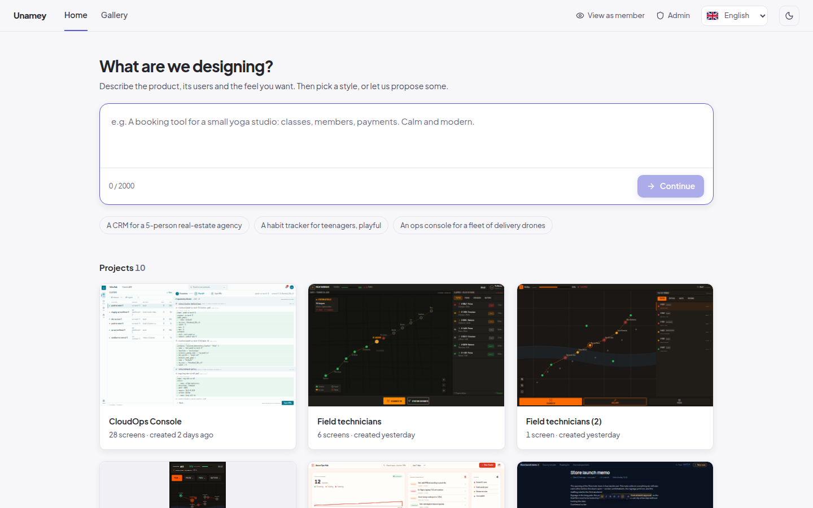
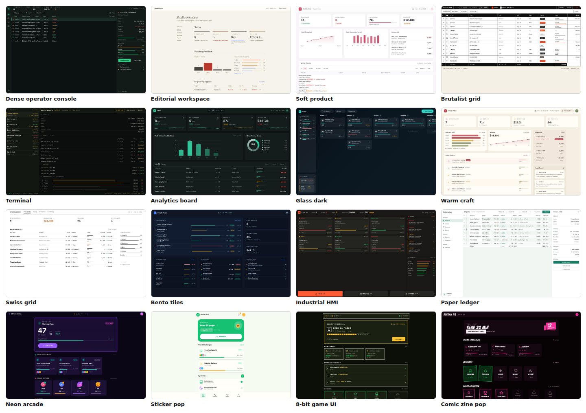
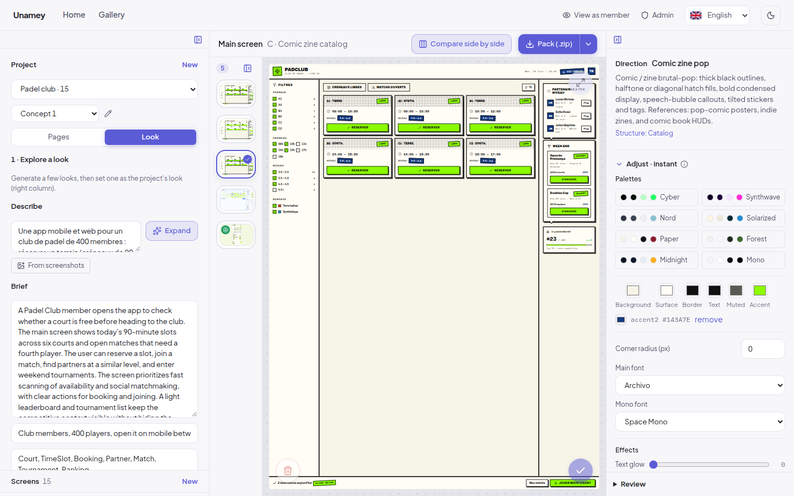
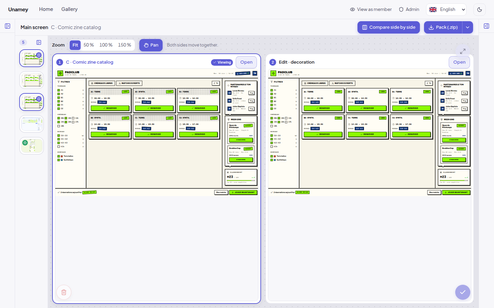
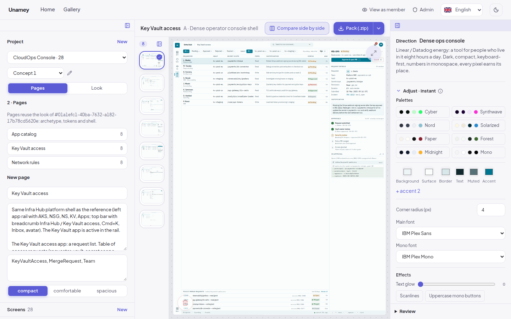
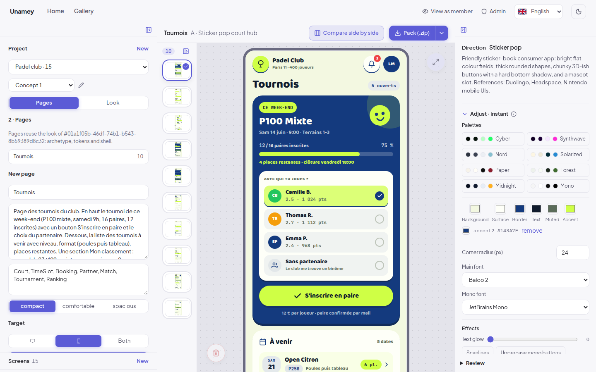
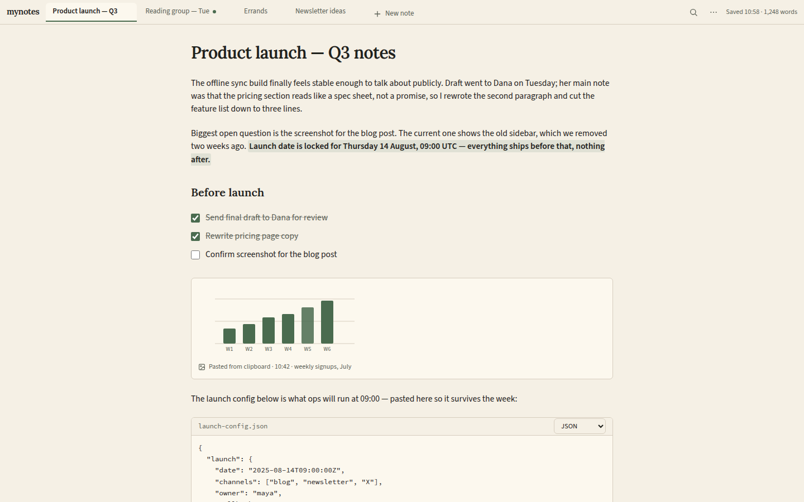
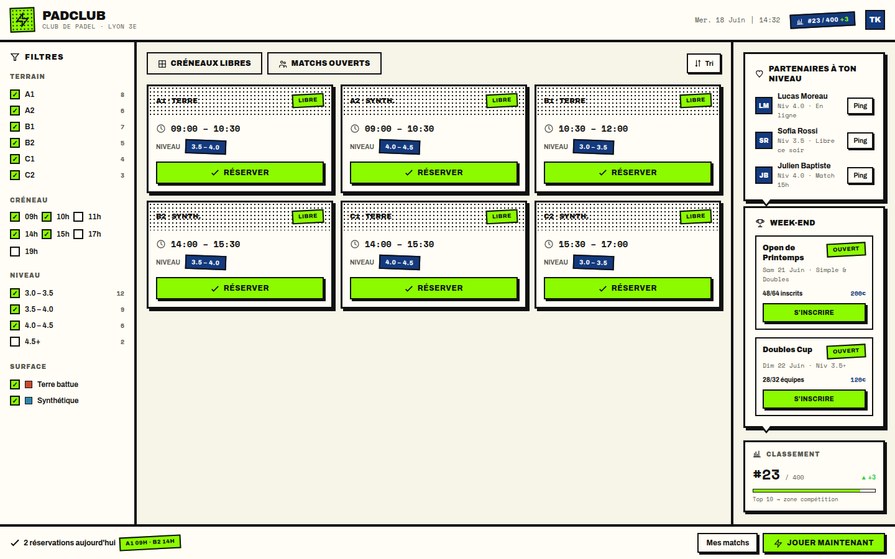
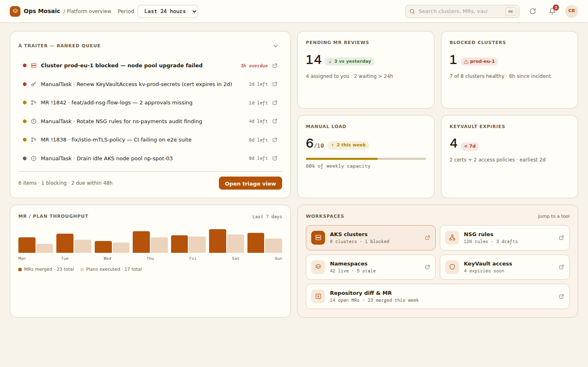
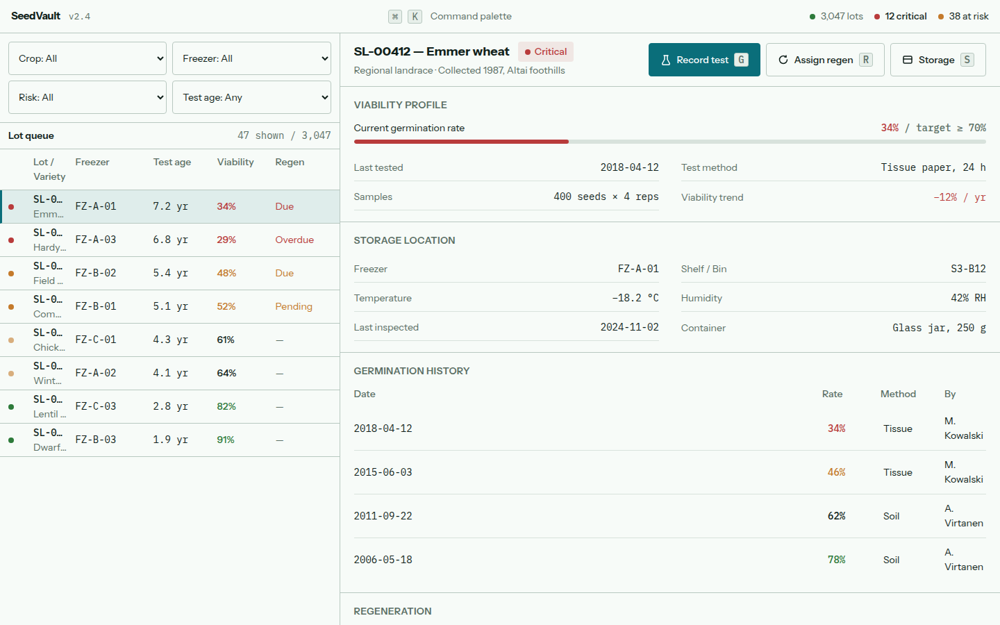

# Unamey

[](VIBECODING.md)

A mockup studio for apps built with coding agents. Describe the product, get several looks as real HTML screens, compare and rework them, pick one, generate the other pages on it, then hand the agent a pack of files to build from: a skill, the tokens, and one HTML page per screen.

The idea is to decide the design on screens you can see, before the agent writes code, instead of correcting it afterwards one prompt at a time. Single Rust binary (`studio`) with a React front, running on a local model or an API provider. Self-hosted, AGPL-3.0.



## What it does, honestly

A strong coding agent (Claude Code with Opus and the `frontend-design` skill, say) already produces a clean, task-fit screen from a two-sentence brief. We measured it on three briefs: on a one-shot screen, Unamey's pack did not make the agent's screen better, and the local model's reference pages were weaker than what Opus drew on its own (`docs/reports/2026-11-19-agent-comparison.md`). So Unamey is not a better screen generator than Opus.

What it gives you is a different workflow:

- **Several concrete looks to choose from**, side by side, before any code exists. The agent gives you one answer; here you get a Swiss grid, a bento board and a dense console of the same product, and you pick.
- **Rework on the mockup, not in the codebase**: change colours, fonts, radius, density or the layout of a screen, refine it bolder or quieter, add a variant in another style. Each step is a new screen you can compare with the previous one.
- **One look for the whole app**: once a look is chosen, every further page (desktop and mobile) is generated on its shell, tokens and navigation. Consistency across screens is where agents drift.
- **The decision as files**: the pack is a `SKILL.md`, a `tokens.css`, a reference page and one HTML per page. It travels between agents, sessions and people, and the agent copies a page instead of inventing one. In the test, that was the cheapest run of its series.
- **Works on a local model.** Everything runs on a 27B model on your machine; an API provider only makes it faster.

Whether this saves correction rounds on a real multi-screen project is the open question. The measurement is in progress, not a result; see the report for the protocol and the numbers.

## Screens

Sixteen styles, each with its layout, neutrals, hues, fonts and do / don't rules. Pick one, or let the planner propose three.



Explore looks of one product, then set one as the project's look. The right column adjusts the tokens live (palette, fonts, radius, effects); the left one holds the brief.



Compare two screens side by side at the same zoom, pan both at once.



Generate the other pages on the chosen look: same shell, tokens and navigation, the look's page as the reference.



Mobile pages are their own screens (390 px, bottom tab bar, 44 px targets), shown in a phone frame.



The gallery keeps every screen, grouped by project, filtered by verdict, style or text.


Some generated pages, as they come out (local model, one shot, no retouch):

| | |
| --- | --- |
|  |  |
|  |  |

## How it works

1. **Brief.** Type a description. One model call expands it into a brief (users, data objects, main task, density, style tags, suggested pages) that you review. Your own words stay binding: the expansion cannot narrow the scope, rename the product or drop a colour you asked for.
2. **Plan.** For each variant, a planner picks one of 16 named structures from the brief (`prompts/structures.json`: master list + detail, board, timeline, dashboard, step flow, live console, record page, catalog...) and one of 16 styles (`prompts/archetypes.json`), different across variants, and writes a design direction: every object the brief names gets a visible region.
3. **Draw.** The model writes a standalone HTML page (Tailwind CDN, inline SVG icons) following the direction and a layout vocabulary (`skill/app-layout-patterns`). Execution calls run at low reasoning effort since the structure is already decided. Optional: the `impeccable` skill counts finish defects.
4. **Rework.** Verdict (good / mixed / bad), refine along one action (bolder, quieter, distill, typeset, colorize, layout), add a variant in another style with the same seed, edit tokens or give a layout-only instruction. Every result is a new screen next to the previous ones.
5. **Pages.** Set a screen as the project's look, then type page names. Each page is generated on that look, desktop, mobile or both. A brief that mentions field use binds 14 px text and 48 px targets; a desktop app brief binds OS window conventions.
6. **Pack.** Export the project pack and copy it into the app you are building.

Share links (`/s/<token>`, read-only, revocable) let someone see a screen without an account. A PNG export renders a screen in a browser or phone frame.

## The pack

`packs/<project>/`:

- `SKILL.md`: product description, the chosen style and structure, a `## Shell` section (the chrome to keep on every screen, in the generator's words), design tokens, do / don't rules, and the list of pages with their briefs.
- `tokens.css`: the tokens as CSS variables, plus the `--success`, `--warning` and `--danger` colours read from the reference page.
- `reference.html`: the look's page, the one to imitate.
- `pages/<page>.html` and `pages/<page>.mobile.html`: one standalone page per screen.

A single screen can be exported the same way (`packs/<id>-<slug>/`, without `pages/`).

Copy the pack to `<app>/.claude/skills/ui-pack/` and ask the coding agent to build the screens following that skill. It gets the style, the tokens and the pages to copy.

## Requirements

- Rust stable, Node 20+, `just`.
- Docker, for the dev PostgreSQL the recipes expect: a container named `devpg` on `127.0.0.1:5432`, user `dev`, password `dev`, allowed to create databases. One way: `docker run -d --name devpg --restart unless-stopped -p 127.0.0.1:5432:5432 -e POSTGRES_USER=dev -e POSTGRES_PASSWORD=dev -e POSTGRES_DB=studio postgres:17`. Deployments set `DATABASE_URL` themselves.
- An OpenAI-compatible LLM endpoint that accepts tool calls. Development uses a llama.cpp-style server running `qwen3.8-27b`, a reasoning model; hosted providers (OpenRouter, OVHcloud AI Endpoints...) work the same way through the Settings drawer.
- Optional: Chromium (`chromium` on PATH) for the PNG export and URL capture.
- Optional: the `impeccable` skill for the finish layer, configured with `STUDIO_IMPECCABLE_DIR`.

## Run

```bash
just dev          # backend on 7700 + Vite on http://localhost:5180
just multi-user   # same, in multi-user mode (accounts)
just build        # front into web/dist + release binary
just run          # serve the built front from the binary on 7700
just test         # cargo test on the dev Postgres + tsc
just lint         # clippy
just dev-reset    # drop the dev data
```

`just dev` needs the dev PostgreSQL (`just db` applies the migrations) and works on `dev-skill/`, copied once from the shipped skill. Open the app once `cargo` has finished compiling; before that, `/api` answers 503. The database starts empty: set a provider in Settings (click the model name in the top bar). `just setup` installs the rango CLI once.

The server binds to `127.0.0.1` by default; `GET /healthz` answers `ok` without auth. Generated HTML is previewed in iframes with `sandbox="allow-scripts"` only, never `allow-same-origin`.

| Variable | Default | Purpose |
| --- | --- | --- |
| `DATABASE_URL` | required | PostgreSQL URL (`just` recipes use the local one) |
| `STUDIO_KEY_FILE` | `studio.key` | master key sealing the provider API keys (created at first use, mode 0600; `just` recipes use `dev.key`, keep it private) |
| `STUDIO_LLM_URL` | `http://127.0.0.1:8000/v1` | seeds the first provider at first start only; settings then live in the DB |
| `STUDIO_MODEL` | `qwen3.8-27b` | seeds the first provider's model at first start only |
| `STUDIO_SKILL_DIR` | `skill/app-layout-patterns` | layout vocabulary used by the generator |
| `STUDIO_PACKS_DIR` | `packs` | exported packs |
| `STUDIO_IMPECCABLE_DIR` | not set | optional `impeccable` skill directory |
| `STUDIO_BIND` | `127.0.0.1` | listen address; `0.0.0.0` behind a proxy |
| `PORT` | `7700` | listen port (`--port` wins) |
| `STUDIO_ORIGIN` | not set | the public origin (`https://…`) switches to multi-user mode |

Providers: each one sets its endpoint, key, models, optional prices (a screen shows its cost only when its model has one) and how many variants run at once (1 for a local model, up to 3 with an API). Routes: the active model draws the pages, an optional cheaper planner model writes the briefs and directions, and up to 5 fallbacks are tried when a model errors.

Multi-user mode: with `STUDIO_ORIGIN` set, the API needs a session. The first account becomes the admin and keeps everything made in local mode; later accounts see their own projects only. Put a TLS reverse proxy in front.

## Docs

- `docs/architecture.md`: layout, HTTP API, schema, security.
- `docs/reports/`: measurements against a coding agent alone.
- `docs/roadmap.md`: what exists and what is next.

## Status

Early, open source. Works end to end on a local model or an API provider. The quality of the generated pages depends on the model behind it: the same pipeline gave a truncated master-detail on the local 27B model and a complete dashboard on a hosted model. Not done yet: a multi-screen measurement of correction rounds, and a blind usability test.

Written with AI assistance (Claude Code and a local model), reviewed by the maintainer: see [VIBECODING.md](VIBECODING.md) and how each claim is checked in [VERIFICATION.md](VERIFICATION.md).

## Contributing, security, licence

- [CONTRIBUTING.md](CONTRIBUTING.md): how to run the checks, AI-assisted contributions.
- [SECURITY.md](SECURITY.md): how to report a vulnerability, what is protected and what is not.
- Licence: [AGPL-3.0](LICENSE). Copyright Ikarys <bikarys@proton.me>.
