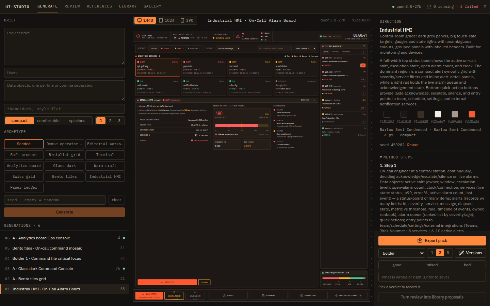
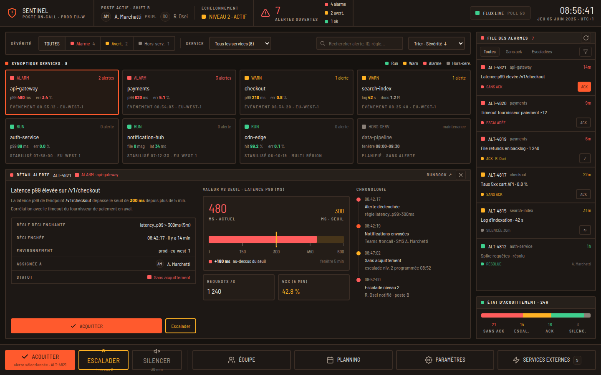
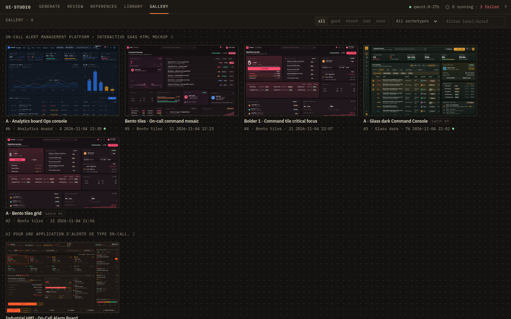

# Unamey

[](VIBECODING.md)

Coding agents, even with a design skill, give web apps screens that are clean but generic: a Bootstrap-like dashboard, whatever the product. The bigger cost is that those screens are visual only. They carry no logic tied to what the application does: the wrong structure for the task, objects the brief names missing or hidden behind tabs. Developers then spend hours and many tokens correcting that with the model, one prompt at a time.

More generic rules do not fix it. What works is deciding the screen from the brief before any style: who uses it, which objects it shows, what the main task is. The planner picks one of 16 named structures from that (master list + detail, board, timeline, step flow...), every object the brief names gets a visible region, and only then is the look forced into one of 12 archetypes with a real page to imitate.

Unamey produces that, per project, from a short brief: a design pack with a standalone reference page and one HTML per page, which a coding agent builds the real screens from. It is a single Rust binary, `studio`, with a React front, running against a local LLM or an API provider. Whether a pack cuts the correction rounds compared with an agent and a design skill alone is being measured, not assumed. The first runs, on a support desk and a seed bank brief, found that the current Opus gets the structure right on its own, that a pack from the local model changed the look, shell and density, and that a pack from a stronger hosted model also set the structure; the saving on multi-screen projects is still to be measured (see `docs/reports/2026-11-19-agent-comparison.md`).

Written with AI assistance (Claude Code and a local model), reviewed by the maintainer: see [VIBECODING.md](VIBECODING.md) and how each claim is checked in [VERIFICATION.md](VERIFICATION.md).



## What you get

The main output is a pack per project. A pack contains:

- `packs[/<project>]/<id>-<slug>/SKILL.md` with the product description and the screen's brief, the chosen archetype and structure, a `## Shell` section (the chrome the generator built, in its own words, to keep on every screen), design tokens, and do / don't rules.
- `packs[/<project>]/<id>-<slug>/tokens.css` with the tokens as CSS variables, plus the `--success`, `--warning` and `--danger` colours read from the reference page.
- `packs[/<project>]/<id>-<slug>/reference.html` with the generated standalone page to imitate.
- `packs/<project>/SKILL.md` + `reference.html` + `pages/<page>.html` (and `pages/<page>.mobile.html` for mobile pages), the project pack built from the project's identity and its pages; the `## Pages` list carries each page's own brief.

Generations can be grouped by project; the pack of a generation in a project is written under `packs/<project>/`.

Before asking a coding agent (Claude Code or similar) to build screens, copy the pack into the app as `.claude/skills/ui-pack/`. The agent then gets the archetype, the tokens, and a page to imitate.



The generator also reads a skill, `app-layout-patterns` in `skill/app-layout-patterns`: a fixed vocabulary of layout, component and UX variants, once learned from reference screenshots. It is shipped as is; the pipeline that built it was removed on 2026-11-06 (see git history).

## How it works

Start from a quick description if you prefer: one model call expands it into the brief, users, data objects, style tags, density, colour wishes and a few suggested pages, which you review before generating. Your own words travel with the generation as a binding constraint (scope, product name, colours), so the expanded brief cannot narrow them; the project is only renamed after a product you named yourself.

Generation starts from a brief: product, users, data objects, density, and style tags. A planner writes one design direction per variant. Each variant is forced into one of 12 archetypes, picked by seed or by hand. The planner also picks one of 16 named structures per variant from the brief (`prompts/structures.json`: master list + detail, board, timeline, canvas + inspector, map + list, dashboard, spreadsheet grid, step flow, live console, record page, single document, feed, catalog, plus three consumer ones), different across variants unless the description fixes the layout ("the whole window for writing": every variant keeps it), so the screens differ in what they are, not only in how they look. A tool loop reads the skill files it needs. The model writes notes and a standalone HTML page using Tailwind CDN and inline SVG icons. `impeccable detect`, an external optional skill, counts finish defects. The `mono` token is checked to be a monospace family (the archetype's otherwise). The result is stored as a generation. Execution calls run with low reasoning effort, since the planner already decided structure and identity: one bento variant takes about 80 s on the local model instead of 180 s, and the job log shows one line per LLM call with seconds, prompt / cached / output tokens and thinking tokens.

The 12 archetypes are listed in `prompts/archetypes.json`:

- Dense operator console
- Editorial workspace
- Soft product
- Brutalist grid
- Terminal
- Analytics board
- Glass dark
- Warm craft
- Swiss grid
- Bento tiles
- Industrial HMI
- Paper ledger

Each archetype has its structure, neutrals, hue and font candidates, and do / don't rules.

After a generation is stored, you can give a verdict: good, mixed, or bad, plus a note. You can refine the page one to three ways (one by default) along one `impeccable` action: bolder, quieter, distill, typeset, colorize, or layout. Opening a generation loads its request back into the form; the action block adds one more variant with another archetype, same brief and seed, next to it. You can export the pack.

Explore variants in a project, pick one as the project's identity, then type a page name to generate further pages under it: same shell, tokens and navigation, the identity's page as reference. Export the project pack for the identity and its pages. With several variants, or several pages of the same concept, "Compare side by side" in the top bar shows two of them as live columns (pick them in the variants strip; the side panels fold away while comparing), at the same zoom and the same sheet height (the taller page sets it), dragging (Pan) or scrolling one side moves both; the full-screen button then gives them the whole screen.

Choose the target per generation: desktop, mobile (a 390px phone page: single column, bottom tab bar, stacked rows, 44px touch targets, same tokens and navigation) or both (the desktop page, then its mobile version built from it). From the home page the target is read from your description (a mobile app gets phone screens) unless you pick one in the Options step. A brief that mentions field use (gloves, sunlight, outdoors, site work) binds the generator to 14px text and 48px targets; every text size under 14px is then counted among the finish findings. A brief that says the product is an installed desktop app (desktop app, app de bureau, Tauri, Electron app, Windows or macOS app, system tray) binds the generator to the OS window conventions (`prompts/desktop_app.md`): the page is the app window with its own title bar and caption buttons, tabs merged into the content surface, neutral OS greys, the accent on a few states only.

Edit a generation without a free prompt: change its tokens in the Direction panel (colours, light / dark, font among the archetype's candidates, mono, radius, density) and / or type a layout-only instruction, then Apply. The result is a new generation with the same structure and the new tokens, or the same tokens and the new arrangement, under the same project, page and target.

## Screens

The UI has two tabs, with keys 1 and 2:

- Generate: describe + Expand (brief helper), brief form, target desktop / mobile / both, archetype select, progress with per-call timing, preview at 1440 / 1024 / 390 px scaled to fit, phone frame for mobile pages, verdict, refine, editable tokens + layout text (Apply), pack export.
- Gallery: all generations as cards with sandboxed thumbnails, filters by verdict / archetype / text, grouped by project (most recent first by default, or by name), then by brief for unsorted screens. Clicking a card opens it in Generate.



The front deliberately follows the Industrial HMI archetype: warm dark, dense, IBM Plex, one orange signal colour, so it does not look like a default dashboard itself. The spec is in `docs/ui-spec.md`.

## Requirements

- Rust stable
- Node 20+
- `just`
- Docker, for the dev PostgreSQL the recipes expect: a container named `devpg` on `127.0.0.1:5432`, user `dev`, password `dev`, allowed to create databases. One way: `docker run -d --name devpg --restart unless-stopped -p 127.0.0.1:5432:5432 -e POSTGRES_USER=dev -e POSTGRES_PASSWORD=dev -e POSTGRES_DB=studio postgres:17`. Deployments set `DATABASE_URL` themselves.
- A local OpenAI-compatible LLM endpoint that accepts images and tool calls. Development used a llama.cpp-style server running `qwen3.8-27b`, a reasoning model. The studio sets `reasoning_effort` low on execution calls.
- The crate `llm-providers-connector` from crates.io (https://github.com/ikarys/llm-providers-connector), fetched by cargo.
- Optional: Chromium (`chromium` on PATH) for URL capture.
- Optional: the `impeccable` skill for the finish layer, configured with `STUDIO_IMPECCABLE_DIR`.

## Run

```bash
just dev
just multi-user
just dev-reset
just build
just run
just pack <id>
just test
just lint
```

`just dev` starts the backend on port 7700 and the Vite dev server. Open http://localhost:5180 (or http://127.0.0.1:5180) once `cargo` has finished compiling: before that, `/api` answers 503 "backend not reachable" and the page needs a reload. It needs the dev PostgreSQL (see Requirements; `just db` applies the migrations) and works on `dev-skill/`, copied once from the exported skill. The database starts empty: set a provider in Settings. `just setup` installs the rango CLI once. `just multi-user` is the same in multi-user mode (see below): create your account on the login screen. `just dev-reset` drops the dev data (recreates the `studio` database).

`just build` builds the front into `web/dist` and the release binary. `just run` serves the built front from the release binary on port 7700 against the local PostgreSQL.

`just pack <id>` writes the pack of a generation (its UUID). `just test` runs `cargo test` (each test on its own fresh copy of the migrated `studio_test` database) and `tsc`. `just lint` runs `clippy`.

The server binds to `127.0.0.1` by default (`STUDIO_BIND`, `PORT`); `GET /healthz` answers `ok` without auth. Generated HTML is previewed in iframes with `sandbox="allow-scripts"` only, never `allow-same-origin`.

Environment variables:

| Variable | Default | Purpose |
| --- | --- | --- |
| `STUDIO_LLM_URL` | `http://127.0.0.1:8000/v1` | seeds the first provider at first start only (settings then live in the DB, edited in the Settings drawer; API keys are sealed with the `STUDIO_KEY_FILE`, keep that file private) |
| `DATABASE_URL` | required | PostgreSQL URL (`just` recipes use the local one) |
| `STUDIO_KEY_FILE` | `studio.key` | master key sealing the provider API keys (created at first use, mode 0600; `just` recipes use `dev.key`) |
| `STUDIO_MODEL` | `qwen3.8-27b` | seeds the first provider's model at first start only |
| `STUDIO_SKILL_DIR` | `skill/app-layout-patterns` | skill directory used by the generator |
| `STUDIO_PACKS_DIR` | `packs` | exported project packs |
| `STUDIO_IMPECCABLE_DIR` | not set | optional `impeccable` skill directory |
| `STUDIO_BIND` | `127.0.0.1` | listen address; `0.0.0.0` behind a proxy or on a platform (with `STUDIO_ORIGIN` set, the local Host guard is off) |
| `PORT` | `7700` | listen port (`--port` wins) |
| `STUDIO_ORIGIN` | not set | set to the public origin (`https://…`) to switch to multi-user mode, see below |

Multi-user mode: with `STUDIO_ORIGIN` set, the API needs a session. Open the app and create an account: the first account becomes the admin and keeps everything made in local mode; the next accounts are members. Members see their own projects only; Settings stays admin-only. Put a TLS reverse proxy in front. Without `STUDIO_ORIGIN` nothing changes for local use.

The endpoint, model and API key can also be changed from the Settings drawer (click the model name in the top bar); saved values live in the `settings` table and override the env vars. Prices per model are optional; a generation shows its cost only when its model has one. Each provider also sets how many variants of one generation run at once (1 for a local model, up to 3 with an API). Routes: the active model writes the pages, an optional planner model writes briefs and plans the looks (a cheaper one is enough), and up to 5 fallbacks are tried in order when a model errors; a failing model is skipped for a minute. Each model can carry request extras, a JSON object merged into its requests, e.g. OpenRouter host pinning `{"provider": {"only": ["deepinfra"], "allow_fallbacks": false}}`. A generation records the model that wrote it; its cost still prices the planner tokens at that model's price.

## Using a pack

Copy `packs[/<project>]/<id>-<slug>/` to `<app>/.claude/skills/ui-pack/`.
For multi-page projects, copy `packs/<project>/` with its `pages/` instead.

Then ask the coding agent to build screens following that skill. It gets the archetype, the tokens, and a page to imitate.

## Docs

- `docs/architecture.md`: layout, HTTP API, schema, security.
- `docs/ui-spec.md`: the studio's own front spec.

## Status

Early, open source. It works end to end with a local model or an API provider. Not done: a blind evaluation of the same brief with and without a pack.

## Contributing, security, licence

- [CONTRIBUTING.md](CONTRIBUTING.md): how to run the checks, AI-assisted contributions.
- [SECURITY.md](SECURITY.md): how to report a vulnerability, what is protected and what is not.
- Licence: [AGPL-3.0](LICENSE). Copyright Ikarys <bikarys@proton.me>.
